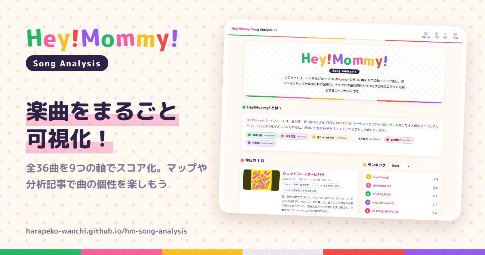

# Hey!Mommy! Song Analysis

**Hey!Mommy!** の楽曲を 9 軸スコアと 3 つのポジションマップで可視化・分析した Web サイトです。

🔗 **サイト:** <https://harapeko-wanchi.github.io/hm-song-analysis/>

---

## Hey!Mommy! について

**Hey!Mommy!**（ヘイマミー）は、振付師・槙田紗子による『SACO PROJECT!』オーディションから 2021 年に誕生した 6 人組の女性アイドルグループです。「いつまでも子ども心を忘れずに、日常に大きな HAPPY を！」をコンセプトに活動しています。

| メンバー | 担当色 |
|----------|--------|
| 原明日香 | Hey!Green!（リーダー・振付師） |
| 秋元悠里 | Hey!Pink! |
| 佐々木ひまわり | Hey!Yellow! |
| 今丘葉月 | Hey!White! |
| 延松舞佳 | Hey!Red! |
| 作島藍 | Hey!Purple! |

### 関連リンク

- [公式サイト](https://www.heymommy.jp/)
- [Wikipedia](https://ja.wikipedia.org/wiki/Hey!Mommy!)
- [X (Twitter)](https://x.com/heymommy123)
- [Instagram](https://www.instagram.com/heymommy1234/)
- [YouTube](https://www.youtube.com/@heymommyofficial8970)
- [TikTok](https://www.tiktok.com/@happyheymommy)

---

## 制作について

- **生成 AI（Claude）** を使用して楽曲の和声分析・スコアリング・Web サイト構築を行いました
- 歌詞とコード進行は **[ChordWiki — Hey!Mommy!](https://ja.chordwiki.org/tag/Hey%21Mommy%21)** の情報を使用しています

---

## サイト構成

ナビゲーションは「楽曲一覧」「分析」「探す」「つくる」の 4 グループです。

| ページ | ファイル | 内容 |
|--------|----------|------|
| **トップ** | `index.html` | Hey!Mommy! とサイトの紹介、おすすめコンテンツ（楽曲一覧・ポジションマップ・似た曲レコメンド）、ランダムに選ぶ「今日の 1 曲」（3 つのマップのエリア名つき）、BPM・9 軸ごとのランキング TOP 5 |

### 楽曲一覧

| ページ | ファイル | 内容 |
|--------|----------|------|
| **楽曲一覧** | `songs.html` | 全楽曲をカード形式で一覧表示。各カードにサムネイル・9 軸スコアバー・summary を掲載し、和声解析・歌詞フック・タグは楽曲詳細ページで表示。作曲家・リリース年・キーワードで絞り込み、リリース日・曲名・BPM・9 軸スコアで並び替えでき、条件は URL で共有可能 |
| **楽曲詳細** | `song.html?id=<曲 id>` | 1 曲ごとのページ。ジャケット・クレジット・タグ・9 軸レーダー・3 つのマップ上の位置・歌詞フック・似ている曲 TOP 5 と、楽曲分析の記事を掲載。一覧・レコメンド・ヒートマップの曲名や、マップの選択曲から開ける |

### 分析

| ページ | ファイル | 内容 |
|--------|----------|------|
| **ポジションマップ** | `map.html` | 3 つのマップをタブで切り替え（ステージ x: かわいい ↔ かっこいい / y: 聴かせる ↔ 沸かせる、サウンド x: エレクトロ ↔ バンド / y: ゆったり ↔ 疾走感、ムード x: 大人っぽい ↔ 子供心 / y: エモーショナル ↔ ハッピー）。曲を選ぶと 3 つのマップでその曲を強調表示。表示中のマップと選択曲は URL で共有可能 |
| **スコアヒートマップ** | `heatmap.html` | 全楽曲 × 9 軸スコアをヒートマップ形式で俯瞰 |
| **年表** | `timeline.html` | 楽曲をリリース順に年ごとに一覧表示。BPM・9 軸スコアから 1 つを選び、各曲の値と年ごとの平均の推移をグラフと表で表示（`?m=<軸>` で共有可能） |
| **作曲家 DNA** | `composer.html` | 作曲家ごとの 9 軸平均スコアをレーダーチャートで可視化。タブ切替で作曲家別の詳細プロフィール（バックグラウンド・和声シグネチャー・BPM 傾向・歌詞テーマなど）と担当楽曲一覧を表示。全作曲家の数値比較テーブルも掲載 |

### 探す

| ページ | ファイル | 内容 |
|--------|----------|------|
| **楽曲レコメンド** | `recommend.html` | 楽曲を 1 曲選ぶと、9 軸スコアのコサイン類似度で近い楽曲 TOP 5 を提示。各軸の一致度バーとレーダーチャート重ね合わせで「なぜ似ているか」を視覚化 |
| **レーダーチャート比較** | `compare.html` | 任意の楽曲を選択し、9 軸レーダーチャートを重ねて比較 |

### つくる

| ページ | ファイル | 内容 |
|--------|----------|------|
| **セトリメーカー** | `setlist.html` | 楽曲を自由に追加・並び替えてセットリストを手動で組める。アンコール区切り挿入・曲ごとのコメント入力・任意のタイトル設定が可能。BPM フロー／ムード推移グラフとアンコール位置の破線マーカーをリアルタイム表示。テーマ（盛り上がり重視・エモ多め・かわいい全開・クール&バンド・バランス・フェス仕様）と曲数を指定した自動生成も搭載。セトリ内容は LZ-String 圧縮 URL で共有可能 |
| **打線メーカー** | `batting.html` | 楽曲で野球の打順を組む。1〜9 番の打者スロットに曲をドラッグ＆ドロップ（モバイルはタップ選択）で配置し、守備位置・投手を設定してコメントを入力。打順と投手欄は LZ-String 圧縮 URL で共有可能。X シェアは 257 文字上限に収まるよう末尾から自動カット |

### 共通ファイル

| ファイル | 説明 |
|----------|------|
| `songs.json` | 全楽曲のメタ情報・9 軸スコア・マップ座標・タグ・和声ノート・歌詞フックを格納 |
| `scripts/lz-string.min.js` | URL 状態共有に使用する LZ-String 圧縮ライブラリ |
| `scripts/map.js` | 3 マップ共通のズーム/パン/ツールチップ処理 |
| `styles/common.css` | サイト全体の共通スタイル（明るい配色・メンバーカラー・丸ゴシック） |

---

## 9 軸スコア

各楽曲を以下の 9 軸で 0〜10 のスコアリング（probit 正規化）しています。

| グループ | 軸 | 説明 |
|----------|----|------|
| **表現** | キュート / クール / エモ | 楽曲の表現スタイル |
| **キャラクター** | 子供心 / ハッピー度 / お祭り感 | 楽曲の性格・雰囲気 |
| **サウンド** | バンド / 疾走感 / 複雑度 | サウンドの特徴 |

各軸の基準と基準になる曲は [docs/scoring.md](docs/scoring.md) にまとめています。

---

## 解析結果

`analysis/` フォルダに全 36 曲の楽曲分析（Markdown）が格納されており、楽曲詳細ページ（`song.html`）で記事として読めます。音楽誌の楽曲分析記事のスタイルで、各記事は次の構成です（書き方の決まりは [docs/analysis-style.md](docs/analysis-style.md)）。

- リード文と基本情報（リリース・クレジット・キー・BPM・編成）
- 聴きどころごとの論考（転調・借用和音・ドミナント進行など）
- 「楽曲を追う」: セクションごとのコード進行と解説
- 「カタログの中で」: 他の曲・同じ作曲家の曲との比較
- 総評

---

## 全体総評

Hey!Mommy! の全 36 曲を横断分析した結果、以下の特徴が浮かび上がります。

### 作家カラーの多様性と統一感

楽曲の約 6 割（36 曲中 21 曲）を **NNBS.** が手がけており、グループのサウンドの核を形成しています。I7（♭7）をシグネチャーとした場面転換、I-V 始動の Verse 構造、ギター＋シンセの厚みあるアレンジが特徴的で、近作の BABY BABY BABY・カラフルポップレジスタンス・Happy Go Round では vi-IV-I-V 循環を軸にした新しい型も定着しつつあります。一方で **AILI**、**しえりーほ**、**山崎あおい** らの楽曲がエモーショナルやチル寄りの領域を埋め、阿久津健太郎・古橋勇紀・早川博隆/柿迫ヒカル・徳田光希・草川瞬といった 1 曲ずつの外部作家が、それぞれ異なる色をカタログに加えています。

### BPM と疾走感の幅広さ

BPM 100（夜空ウィズユー）から 220（MY FIRST LOVE SONG、Happy Go Round）まで非常に幅広く、アイドルグループとしては異例のスピードレンジを持ちます。BPM 190 超の楽曲が 11 曲あり、BPM 上位 5 曲（220・220・210・206・200）はすべて NNBS. 作品です。ライブでの盛り上がりを強く意識した構成といえます。

### 「かわいい」と「かっこいい」の両立

ステージマップ（Map A）を見ると、最も多いのは左上（かわいい×沸かせる）の 12 曲で、もちぷる・BABY BABY BABY・Happy Go Round などが並びます。右側（かっこいい）にも MAGNET、Hey! get up kids、DIAMOND JET などが展開し、残る 3 象限にも 8 曲ずつが分布しています。縦軸（聴かせる↔沸かせる）では上半分（沸かせる）がやや多く、ライブパフォーマンス志向の強いグループであることが数値的にも裏付けられます。

### エモーショナル楽曲の存在感

ハッピーでポップな楽曲が多数を占める中、Next Story、SUMI-HAJI、MAGNET、OK といった楽曲がムードマップ（Map C）の下方に位置し、グループの表現の深みを支えています。特に Next Story はエモ 9.9 でカタログ最高値を記録し、クールの最高値 9.9 は MAGNET が持っています。

### サウンド面の進化

リリース年ごとの平均で見ると、バンド感は 2022 年の 5.3 から 2024 年の 4.0 まで打ち込み寄りに下がった後、2025 年 5.4、2026 年 6.2 と再び上昇しています。Hey! get up kids（バンド 9.9）や MY FIRST LOVE SONG に加え、2026 年はギターソロを含むカラフルポップレジスタンスや、単音リフ主体のジェットコースターLIFE!! が続きました。複雑度の平均も 2023 年の 3.2 から 2025 年の 7.5 へ大きく伸びており（Hey!Yummy! 9.9、POJI POJI GO 8.2 など）、音楽的な成熟が進んでいることが分かります。

---

## ライセンス

本リポジトリのソースコードは [MIT License](LICENSE) のもとで公開されています。

楽曲の著作権は各権利者に帰属します。本リポジトリは分析・可視化を目的としたファンプロジェクトです。
